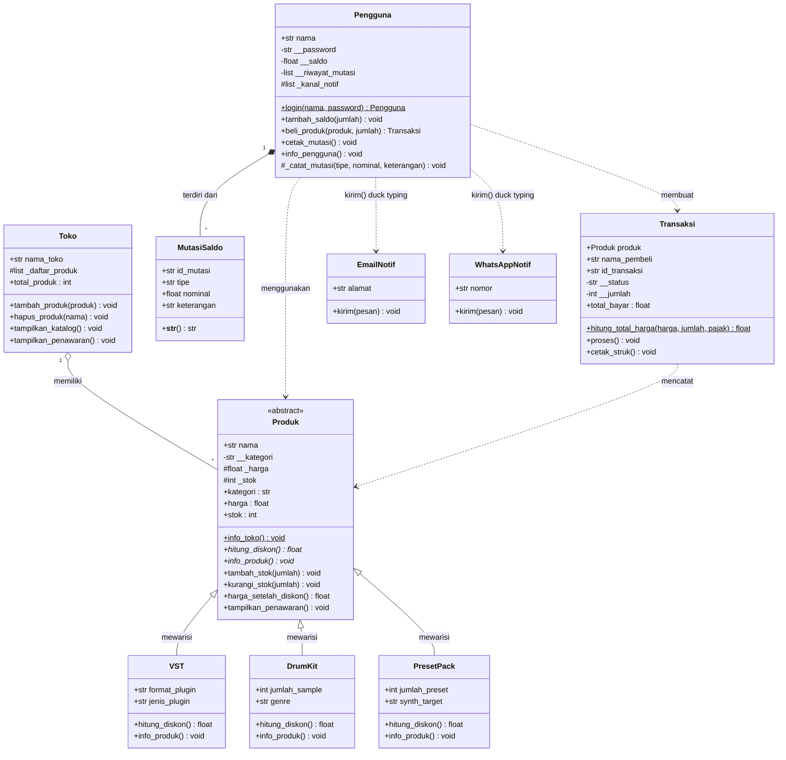

# SoundPlam: Sistem Manajemen Penjualan Plugin VST, Drum Kit, dan Preset Pack

| | |
|---|---|
| **Nama** | Muhamad Farid Al Mubarok |
| **NIM** | 2509106087 |
| **Kelas** | B2'25 |
| **Mata Kuliah** | Pemrograman Berorientasi Objek |
| **Tugas** | Post Test 3: Polimorfisme dan Abstraksi |

---

## 1. Deskripsi Program

SoundPlam adalah program simulasi toko digital yang menjual **Plugin VST**, **Drum Kit**, dan **Preset Pack**. Program mengelola produk beserta stoknya, akun pengguna beserta saldonya, dan transaksi pembelian yang menghitung total bayar (harga dikali jumlah ditambah pajak). Setelah pembelian berhasil, pembeli menerima notifikasi lewat Email dan WhatsApp.

Program dibuat dengan pendekatan OOP dan dikembangkan bertahap dari tiga post test sebelumnya:

| Modul | Materi | Penerapan di program |
|---|---|---|
| 1 | Class & Object | Class `Produk`, `Transaksi`, `Pengguna` dan objeknya |
| 2 | Atribut & Method | Atribut kelas, atribut instance, instance method, class method, static method |
| 3 | Encapsulation & Property | Atribut private (`__`), `@property`, `@nama.setter` dengan validasi |
| 4 | UML Class Relationships | Asosiasi, agregasi, dan komposisi antar class |
| 5 | Inheritance | `VST` dan `DrumKit` mewarisi `Produk`, `super().__init__()`, atribut protected dan private |
| **6** | **Polimorfisme & Abstraksi** | **`Produk` menjadi Abstract Base Class, override method, duck typing (Post Test 3)** |
| **7** | **Prinsip SOLID (nilai plus)** | **OCP lewat `PresetPack` dan DIP lewat `kanal_notif` (Post Test 3)** |

---

## 2. Struktur File

```
PostTest-3/
├── main.py         # Program utama: pemanggilan dan bukti seluruh konsep
├── soundplam.py    # Seluruh class (OOP)
└── README.md       # Laporan
```

Jalankan program dengan `python main.py`. Pastikan `soundplam.py` berada di folder yang sama.

---

## 3. Perubahan pada Post Test 3

### 3.1 Class Baru

| Class | Jenis | Fungsi |
|---|---|---|
| `PresetPack` | Subclass ketiga dari `Produk` | Produk berkategori Preset Pack. Atribut unik: `jumlah_preset`, `synth_target`. Ditambahkan tanpa mengubah class lain (OCP) |
| `EmailNotif` | Kanal notifikasi (tanpa parent) | Mengirim pesan lewat email, punya method `kirim()` |
| `WhatsAppNotif` | Kanal notifikasi (tanpa parent) | Mengirim pesan lewat WhatsApp, punya method `kirim()` |

Selain itu ada fungsi `beritahu_pembeli(kanal_list, pesan)` yang memanggil `kirim()` pada kanal apa pun (duck typing).

### 3.2 Class yang Diperbarui

| Class | Perubahan | Alasan |
|---|---|---|
| `Produk` | Sekarang mewarisi `ABC`, sehingga menjadi **abstract class** dan tidak bisa diinstansiasi | Menerapkan abstraksi |
| `Produk` | Menambah dua `@abstractmethod`: `hitung_diskon()` dan `info_produk()` | Kontrak yang wajib dipenuhi semua subclass |
| `Produk` | Menambah method konkret `harga_setelah_diskon()` dan `tampilkan_penawaran()` | Alur bersama yang dipakai semua subclass |
| `Produk` | `kategori_produk` bertambah menjadi `["VST Plugin", "Drum Kit", "Preset Pack"]` | Agar `PresetPack` lolos validasi kategori |
| `VST` dan `DrumKit` | Mengimplementasikan `hitung_diskon()` dengan diskon berbeda, dan `info_produk()` tidak lagi memanggil `super()` | Method abstrak wajib diimplementasikan penuh |
| `Toko` | Menambah method `tampilkan_penawaran()` | Menampilkan harga diskon semua produk lewat satu loop (polimorfisme) |
| `Pengguna` | Konstruktor menerima parameter `kanal_notif=None` | Dependency injection (DIP) |
| `Pengguna` | `beli_produk()` memanggil `beritahu_pembeli()` setelah transaksi berhasil | Notifikasi lewat duck typing |
| `Pengguna` dan `Produk` | Pesan error `tambah_stok`, `kurangi_stok`, dan `tambah_saldo` diperjelas menjadi "harus lebih dari 0" | Pesan lama berbunyi "tidak boleh negatif" padahal angka 0 juga ditolak |

Class `Transaksi` dan `MutasiSaldo` tidak berubah.

---

## 4. Struktur Class

### 4.1 Class `Produk` (Abstract Base Class)

Superclass abstrak untuk semua produk yang dijual. Objeknya tidak bisa dibuat langsung, hanya lewat subclass.

**Atribut kelas**

| Atribut | Nilai awal | Fungsi |
|---|---|---|
| `nama_toko` | `"SoundPlam"` | Nama toko |
| `jumlah_produk` | `0` | Penghitung jumlah objek produk yang berhasil dibuat |
| `kategori_produk` | `["VST Plugin", "Drum Kit", "Preset Pack"]` | Daftar kategori valid, dipakai untuk validasi |

**Atribut instance**

| Atribut | Akses | Keterangan |
|---|---|---|
| `nama` | Public | Nama produk |
| `__kategori` | Private | Diakses lewat property `kategori` |
| `_harga` | Protected | Diakses lewat property `harga`, boleh dipakai subclass |
| `_stok` | Protected | Diakses lewat property `stok`, boleh dipakai subclass |

**Property (getter dan setter bernama sama)**

| Property | Validasi di setter |
|---|---|
| `kategori` | Harus salah satu dari `kategori_produk` |
| `harga` | Harus angka (`int` atau `float`) dan tidak boleh negatif |
| `stok` | Harus bilangan bulat (`int`) dan tidak boleh negatif |

**Method**

| Method | Jenis | Fungsi |
|---|---|---|
| `hitung_diskon()` | **Abstract method 1** | Besar diskon, ditentukan tiap subclass |
| `info_produk()` | **Abstract method 2** | Menampilkan info produk, ditentukan tiap subclass |
| `harga_setelah_diskon()` | **Method konkret** | `harga - hitung_diskon()` |
| `tampilkan_penawaran()` | **Method konkret** | Mencetak harga awal, diskon, dan harga akhir |
| `tambah_stok(jumlah)` | Method konkret | Menambah stok, jumlah harus bilangan bulat lebih dari 0 |
| `kurangi_stok(jumlah)` | Method konkret | Mengurangi stok, jumlah tidak boleh melebihi stok |
| `info_toko()` | Class method | Menampilkan `nama_toko` dan `jumlah_produk` |

### 4.2 Subclass `VST`, `DrumKit`, dan `PresetPack`

| Class | Kategori | Atribut unik | Diskon | Info tambahan di `info_produk()` |
|---|---|---|---|---|
| `VST` | `"VST Plugin"` | `format_plugin`, `jenis_plugin` | 10% | Format, jenis, dan status lisensi (`Habis` jika stok 0, `Hampir habis` jika stok 5 ke bawah, selain itu `Tersedia`) |
| `DrumKit` | `"Drum Kit"` | `jumlah_sample`, `genre` | 60% | Jumlah sample, genre, dan harga per sample |
| `PresetPack` | `"Preset Pack"` | `jumlah_preset`, `synth_target` | 5% | Jumlah preset dan synth tujuan |

Ketiganya memanggil `super().__init__(nama, kategori, harga, stok)` dengan kategori yang sudah ditetapkan, sehingga tidak mungkin salah input kategori.

### 4.3 Kanal Notifikasi

| Class | Atribut | Method |
|---|---|---|
| `EmailNotif` | `alamat` | `kirim(pesan)` |
| `WhatsAppNotif` | `nomor` | `kirim(pesan)` |

### 4.4 Class `Transaksi`

Merepresentasikan satu pembelian. Memakai objek `Produk` untuk mengambil harga dan mengurangi stok.

| Atribut kelas | Nilai awal | Fungsi |
|---|---|---|
| `pajak` | `0.11` | Tarif pajak 11% |
| `jumlah_transaksi` | `0` | Penghitung transaksi, dipakai untuk ID (`SDP-1`, dst.) |
| `total_pendapatan` | `0` | Bertambah hanya saat transaksi **berhasil** |
| `riwayat` | `[]` | Daftar transaksi yang berhasil |

| Atribut instance | Akses | Keterangan |
|---|---|---|
| `produk`, `nama_pembeli`, `harga_satuan`, `pajak_transaksi`, `id_transaksi` | Public | `harga_satuan` dan `pajak_transaksi` adalah salinan saat transaksi dibuat |
| `__status` | Private | `"Pending"`, `"Berhasil"`, atau `"Gagal"` |
| `__jumlah` | Private | Jumlah unit yang dibeli |

| Method | Jenis | Fungsi |
|---|---|---|
| `jumlah` (property) | Setter dengan validasi | Bilangan bulat lebih dari 0, hanya boleh diubah saat status `Pending` |
| `status`, `total_bayar` (property) | Tanpa setter | Dikelola program, tidak bisa dimanipulasi dari luar |
| `hitung_total_harga(harga_satuan, jumlah, pajak)` | Static method | `subtotal + subtotal * pajak` |
| `info_transaksi()` | Class method | Ringkasan transaksi dan pendapatan |
| `proses()` | Instance method | Mengecek status dan stok, memanggil `produk.kurangi_stok()` (method konkret), mengubah status, mencatat riwayat |
| `cetak_struk()` | Instance method | Menampilkan rincian transaksi |

### 4.5 Class `Pengguna`

| Atribut | Akses | Keterangan |
|---|---|---|
| `jumlah_pengguna`, `daftar_pengguna` | Atribut kelas | Penghitung dan daftar semua pengguna (dipakai untuk login) |
| `nama` | Public | Username |
| `__password`, `__saldo`, `__riwayat_mutasi` | Private | Diakses lewat property atau method |
| `_kanal_notif` | Protected | Daftar kanal notifikasi yang **disuntikkan dari luar** |

| Method | Jenis | Fungsi |
|---|---|---|
| `login(nama, password)` | Class method | Mengembalikan objek pengguna jika cocok, atau `None` |
| `tambah_saldo(jumlah)` | Instance method | Menambah saldo dan mencatat mutasi |
| `beli_produk(produk, jumlah)` | Instance method | Mengecek stok dan saldo, membuat `Transaksi`, memotong saldo, mencatat mutasi, lalu mengirim notifikasi |
| `cetak_mutasi()`, `info_pengguna()` | Instance method | Menampilkan mutasi dan info akun |

### 4.6 Class `Toko` dan `MutasiSaldo`

| Class | Fungsi |
|---|---|
| `Toko` | Menampung daftar `Produk` (agregasi). Method: `tambah_produk()`, `hapus_produk()`, `tampilkan_katalog()`, `tampilkan_penawaran()` |
| `MutasiSaldo` | Catatan mutasi saldo milik `Pengguna` (komposisi). Memakai magic method `__str__()` untuk tampilan cetak |

---

## 5. Abstraksi (Abstract Base Class)

### 5.1 Abstract class dan abstract method

`Produk` mewarisi `ABC` dan memiliki dua method bertanda `@abstractmethod`. Method ini hanya menjadi **kontrak** dan tidak punya implementasi final.

```python
from abc import ABC, abstractmethod

class Produk(ABC):
    @abstractmethod
    def hitung_diskon(self):      # Abstrak method 1
        pass

    @abstractmethod
    def info_produk(self):        # Abstrak method 2
        pass
```

### 5.2 Implementasi pada subclass

Tiga subclass mengimplementasikan **kedua** abstract method (syarat minimal 2 subclass).

| Subclass | `hitung_diskon()` | `info_produk()` |
|---|---|---|
| `VST` | `self._harga * 0.10` | Mencetak info umum, format, jenis, status lisensi |
| `DrumKit` | `self._harga * 0.6` | Mencetak info umum, jumlah sample, genre, harga per sample |
| `PresetPack` | `self._harga * 0.05` | Mencetak info umum, jumlah preset, synth tujuan |

### 5.3 Method konkret yang dipakai bersama

Method konkret ditulis **sekali** di `Produk` dan diwarisi semua subclass tanpa ditulis ulang. Pola ini sama seperti `jalankan()` pada materi: method konkret menjalankan alur yang sama dan memanggil abstract method, sedangkan hasilnya ditentukan masing-masing subclass.

```python
def harga_setelah_diskon(self):
    return self._harga - self.hitung_diskon()      # hitung_diskon() beda tiap subclass

def tampilkan_penawaran(self):
    print(f"  {self.nama:<22} Rp{self._harga:>9,.0f} -> Diskon Rp{self.hitung_diskon():>8,.0f} "
          f"-> Rp{self.harga_setelah_diskon():>9,.0f}")
```

`kurangi_stok()` juga method konkret dan dipanggil oleh `Transaksi.proses()` untuk produk jenis apa pun.

### 5.4 Bukti abstract class tidak bisa diinstansiasi

Kode di `main.py`:

```python
try:
    produk_langsung = Produk("Coba", "VST Plugin", 1000, 1)
except TypeError as e:
    print(f"TypeError: {e}")
```

Output:

```
TypeError: Can't instantiate abstract class Produk without an implementation for abstract methods 'hitung_diskon', 'info_produk'
```

Error muncul **saat objek dibuat**, bukan saat method dipanggil, sehingga kelas yang tidak lengkap langsung ketahuan sebelum program berjalan lebih jauh.

---

## 6. Polimorfisme

### 6.1 Polimorfisme via pewarisan

Method `hitung_diskon()` dan `info_produk()` di-override oleh tiga subclass dengan perilaku berbeda. Pemanggilannya lewat **satu loop** di class `Toko` yang berisi objek dari subclass berbeda:

```python
def tampilkan_katalog(self):
    for produk in self._daftar_produk:      # isi: VST, DrumKit, PresetPack
        produk.info_produk()                # tiap objek menampilkan versinya sendiri

def tampilkan_penawaran(self):
    for produk in self._daftar_produk:
        produk.tampilkan_penawaran()        # diskon tiap objek berbeda (10%, 60%, 5%)
```

Python memilih implementasi yang tepat saat program berjalan (*dynamic dispatch*).

### 6.2 Duck typing

`EmailNotif` dan `WhatsAppNotif` **tidak berhubungan lewat pewarisan** (tidak punya parent bersama), tetapi sama-sama memiliki method `kirim()`. Keduanya dipanggil lewat satu fungsi yang sama:

```python
class EmailNotif:
    def kirim(self, pesan):
        print(f"  [EMAIL => {self.alamat}] {pesan}")

class WhatsAppNotif:
    def kirim(self, pesan):
        print(f"  [WA => {self.nomor}] {pesan}")

def beritahu_pembeli(kanal_list, pesan):
    for kanal in kanal_list:
        kanal.kirim(pesan)          # tidak peduli tipe kanalnya
```

### 6.3 Larangan anti-pattern

Program **tidak** membedakan perilaku objek dengan rantai `if/elif` yang memeriksa `type()` atau string jenis. Perbandingannya:

```python
# [BURUK] tidak dipakai di program ini
def hitung_diskon_produk(produk):
    if type(produk) == VST:
        return produk.harga * 0.10
    elif type(produk) == DrumKit:
        return produk.harga * 0.6

# [BENAR] yang dipakai: setiap objek menentukan perilakunya sendiri
def hitung_diskon_produk(produk):
    return produk.hitung_diskon()
```

Satu-satunya `isinstance(produk, Produk)` di program dipakai untuk **memvalidasi input** (memastikan yang diterima memang produk), bukan untuk membedakan perilaku antar jenis produk.

---

## 7. Penerapan Prinsip SOLID (Nilai Plus)

| Prinsip | Bagian program | Penjelasan |
|---|---|---|
| **OCP** (Open/Closed Principle) | Class `PresetPack` | Jenis produk baru ditambahkan **hanya dengan membuat satu class baru**. Class `Produk`, `VST`, `DrumKit`, `Toko`, dan `Pengguna` tidak diubah sama sekali, tetapi `Toko.tampilkan_katalog()` dan `tampilkan_penawaran()` langsung bisa memprosesnya |
| **DIP** (Dependency Inversion Principle) | Konstruktor `Pengguna` dan `beli_produk()` | `Pengguna` **tidak membuat** `EmailNotif` atau `WhatsAppNotif` sendiri. Daftar kanal dikirim dari luar lewat parameter `kanal_notif` (dependency injection). Kanal baru (misalnya Telegram) cukup dibuat dengan method `kirim()` dan disuntikkan tanpa mengubah `Pengguna` |

```python
class Pengguna:
    def __init__(self, nama, password, saldo, kanal_notif=None):   # DIP: disuntikkan dari luar
        ...
        self._kanal_notif = kanal_notif if kanal_notif is not None else []

# di main.py
kanal_budi = [EmailNotif("budi@mail.com"), WhatsAppNotif("0812-1234-5678")]
budi = Pengguna("budi", "rahasia123", 5_000_000, kanal_notif=kanal_budi)
```

---

## 8. Diagram UML



### 8.1 Notasi yang Dipakai

| Notasi | Arti | Contoh pada diagram |
|---|---|---|
| `<<abstract>>` | Abstract class | `Produk` |
| `*` di akhir method | Abstract method | `hitung_diskon() float*` |
| `<\|--` | Pewarisan | `Produk <\|-- VST` |
| `o--` | Agregasi | `Toko o-- Produk` |
| `*--` | Komposisi | `Pengguna *-- MutasiSaldo` |
| `..>` | Asosiasi atau dependensi | `Pengguna ..> Produk` |
| `+`, `#`, `-` | Public, protected, private | `+nama`, `#_harga`, `-__kategori` |
| `$` | Static atau class method | `info_toko()`, `login()` |

Perhatikan bahwa `EmailNotif` dan `WhatsAppNotif` **tidak punya garis pewarisan** satu sama lain maupun ke class lain. Itulah ciri duck typing: keduanya terhubung hanya lewat kesamaan nama method `kirim()`.

### 8.2 Cara Membaca Diagram

| Relasi | Dibaca |
|---|---|
| `Produk <\|-- VST`, `DrumKit`, `PresetPack` | Ketiganya adalah jenis `Produk` (pewarisan) |
| `Toko "1" o-- "*" Produk` | Satu `Toko` memiliki banyak `Produk` (agregasi) |
| `Pengguna "1" *-- "*" MutasiSaldo` | Satu `Pengguna` terdiri dari banyak `MutasiSaldo` (komposisi) |
| `Pengguna ..> Produk` | `Pengguna` menggunakan `Produk` lewat parameter `beli_produk()` |
| `Pengguna ..> Transaksi` | `Pengguna` membuat `Transaksi` saat membeli |
| `Transaksi ..> Produk` | `Transaksi` mencatat produk yang dibeli |
| `Pengguna ..> EmailNotif` dan `WhatsAppNotif` | `Pengguna` memanggil `kirim()` pada kanal yang disuntikkan |

---

## 9. Konsep dari Post Test Sebelumnya yang Tetap Dipakai

### 9.1 UML Class Relationships

| Aspek | Asosiasi | Agregasi | Komposisi |
|---|---|---|---|
| Class yang terlibat | `Pengguna` dan `Produk` | `Toko` dan `Produk` | `Pengguna` dan `MutasiSaldo` |
| Kata kunci | "menggunakan" | "memiliki" | "terdiri dari" |
| Lokasi pembuatan objek bagian | Di luar, dikirim lewat parameter | Di luar, dikirim ke penampung (list) | Di dalam objek induk |
| Jika objek induk dihapus | Objek yang dipakai tetap ada | Anggota tetap ada | Objek bagian ikut musnah |

### 9.2 Inheritance

Tipe yang dipakai adalah **hierarchical inheritance**: satu superclass (`Produk`) diwarisi tiga subclass (`VST`, `DrumKit`, `PresetPack`). Semua subclass memanggil `super().__init__(...)`, memiliki atribut unik, dan memakai tingkat akses berikut:

| Tingkat | Atribut | Alasan |
|---|---|---|
| Protected (`_`) | `_harga`, `_stok` | Subclass membutuhkannya langsung (`_stok` untuk status lisensi, `_harga` untuk diskon dan harga per sample) |
| Private (`__`) | `__kategori` | Rahasia milik `Produk`, subclass hanya membaca lewat property `kategori` |

---

## 10. Aturan Validasi

Setter dan method yang menerima data tidak valid akan **melempar exception** (`ValueError` atau `TypeError`) dan tidak mengubah nilai lama.

| Class | Property / method | Aturan | Pesan jika ditolak |
|---|---|---|---|
| `Produk` | `harga` | Angka, tidak negatif | `Harga harus berupa angka` / `Harga tidak boleh negatif` |
| `Produk` | `stok` | Bilangan bulat, tidak negatif | `Stok harus berupa angka` / `Stok tidak boleh negatif` |
| `Produk` | `kategori` | Ada di `kategori_produk` | `Kategori tidak valid...` |
| `Produk` | `tambah_stok()`, `kurangi_stok()` | Bilangan bulat lebih dari 0, pengurangan tidak melebihi stok | `Jumlah stok ... harus lebih dari 0` / `...melebihi stok yang tersedia` |
| `Pengguna` | `saldo` | Tidak negatif | `Saldo tidak boleh negatif` |
| `Pengguna` | `password` | Minimal 6 karakter | `Password harus minimal 6 karakter` |
| `Pengguna` | `tambah_saldo()` | Lebih dari 0 | `Jumlah saldo yang ditambahkan harus lebih dari 0` |
| `Transaksi` | `jumlah` | Bilangan bulat lebih dari 0, status `Pending` | `Jumlah harus lebih dari 0` / `Transaksi sudah diproses...` |

---

## 11. Panduan Pengujian

Pengujian dilakukan lewat `main.py`. Jalankan `python main.py`, lalu cocokkan hasilnya dengan tabel di bawah.

### Data awal

| Objek | Data |
|---|---|
| `serum` (VST) | Serum Wavetable, Rp2.500.000, stok 10, format VST3/AU, jenis Synthesizer |
| `trap_kit` (DrumKit) | Trap Essentials, Rp350.000, stok 3, 120 sample, genre Trap |
| `lofi` (PresetPack) | Lo-Fi Presets Vol.1, Rp200.000, stok 8, 64 preset, untuk Serum |
| `toko` (Toko) | Toko bernama SoundPlam |
| `budi` (Pengguna) | password `rahasia123`, saldo Rp5.000.000, kanal Email dan WhatsApp |

### Pengujian 1: Bukti abstraksi


### Pengujian 2: Inheritance dan agregasi


### Pengujian 3: Polimorfisme via pewarisan (`info_produk()`) dan method konkret (`hitung_diskon()`)


### Pengujian 4: Duck typing


### Pengujian 5: Pembelian, DIP, dan method konkret `kurangi_stok()`


### Cakupan pengujian terhadap syarat Post Test 3

| Yang diuji | Pengujian |
|---|---|
| Abstract class tidak bisa diinstansiasi | 1 |
| Minimal 2 subclass mengimplementasikan abstract method | 3, 4 |
| Method konkret dipakai bersama | 4, 6 |
| `super().__init__()`, atribut unik, protected dan private | 2, 3 |
| Polimorfisme via pewarisan (1 loop, subclass berbeda) | 3, 4 |
| Duck typing (2 kelas tanpa pewarisan, 1 fungsi) | 5, 6 |
| Tanpa anti-pattern `if/elif type()` | Seluruh program, tidak ada pengecekan jenis dengan `type()` atau string |
| SOLID (OCP dan DIP) | 3, 4 (`PresetPack` ikut diproses tanpa mengubah class lain), 6 (kanal disuntikkan ke `Pengguna`) |

---

## 12. Ringkasan Pemenuhan Syarat Post Test 3

| Syarat | Terpenuhi oleh |
|---|---|
| Minimal 1 abstract class dengan minimal 2 `@abstractmethod` | `Produk(ABC)` dengan `hitung_diskon()` dan `info_produk()` |
| Minimal 2 subclass mengimplementasikan seluruh abstract method | `VST`, `DrumKit`, dan `PresetPack` |
| Minimal 1 method konkret yang dipakai bersama | `harga_setelah_diskon()`, `tampilkan_penawaran()`, `tambah_stok()`, `kurangi_stok()` |
| Bukti abstract class tidak bisa diinstansiasi | `try-except TypeError` di `main.py`, output pada bagian 5.4 |
| Konsep inheritance tetap dipakai | `super().__init__()`, atribut unik tiap subclass, protected (`_harga`, `_stok`) dan private (`__kategori`) |
| Polimorfisme via pewarisan | `hitung_diskon()` dan `info_produk()` di-override tiga subclass, dipanggil lewat satu loop di `Toko` |
| Duck typing | `EmailNotif` dan `WhatsAppNotif` dipanggil lewat `beritahu_pembeli()` |
| Larangan anti-pattern | Tidak ada rantai `if/elif` yang mengecek `type()` atau string jenis |
| Nilai plus: SOLID | OCP lewat `PresetPack`, DIP lewat `kanal_notif` (bagian 7) |